---

### `$ ls ~/featured`

- **[ChatOn-Global](https://github.com/JackRipper-ID/ChatOn-Global)** — global chat in your terminal
- **[AjralDEV-Kernel-c2q](https://github.com/JackRipper-ID/AjralDEV-Kernel-c2q)** — KernelSU Next + NetHunter, one image
- **[termux-beautify](https://github.com/JackRipper-ID/termux-beautify)** — hacker theme for Termux

